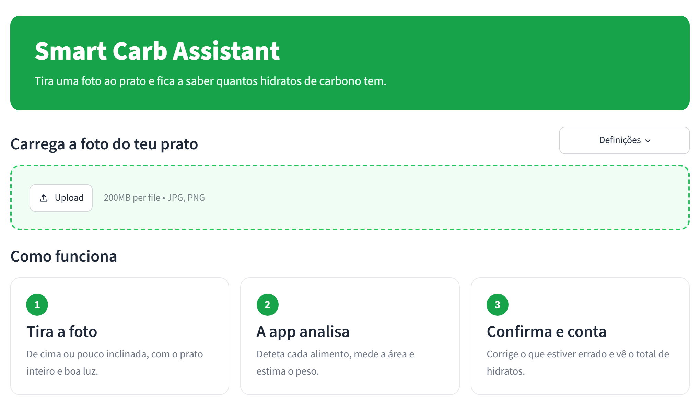

# Smart Carb Assistant

Estima os **hidratos de carbono de um prato a partir de uma foto**: deteta os alimentos, estima o peso
de cada um e calcula os hidratos com a tabela da APDP (Associação Protetora dos Diabéticos de Portugal).

**Motivação:** sou diabético tipo 1 e conto hidratos a cada refeição para calcular a dose de insulina.
Em restaurantes não há balança, por isso a contagem é feita "a olho".

> **Nota:** é uma estimativa com erros de dezenas de gramas. Não substitui a pesagem nem a orientação médica.



## Como funciona

```
Foto → 1. Encontrar o prato (escala) → 2. Detetar alimentos (área em cm²) → 3. Estimar peso → 4. Calcular hidratos → 5. Utilizador confirma
```

1. **Escala:** o prato é encontrado com o YOLO-World (deteção a partir de texto: "plate"). Assumindo um prato
   de 26 cm, sabe-se quantos píxeis correspondem a 1 cm. A escala é calculada na horizontal e na vertical
   em separado, para corrigir fotos tiradas de lado. (A primeira versão procurava um círculo branco com OpenCV,
   mas falhava com pratos de cor, fotos tiradas de lado e taças ao lado do prato.)
2. **Alimentos:** um YOLOv8s-seg que treinei no dataset FoodSeg103 (103 classes) recorta cada alimento e mede
   a sua área.
3. **Peso:** `peso = área × gramas por cm²`, com os gramas por cm² de cada categoria **aprendidos com dados
   reais** (ver resultados abaixo).
4. **Hidratos:** cada classe do modelo está ligada a uma linha de `dados/tabela_alimentos.xlsx`, criada a partir
   do PDF da APDP. Carne, peixe, ovo e legumes contam 0 g, como indica a APDP.
5. **Confirmação:** na app, o utilizador pode corrigir o alimento (ex: batata cozida → assada) e o peso.

## Resultados

### Detetar os alimentos

Comecei com um YOLOv8n-seg já treinado no FoodSeg103 (de
[gorkatorres](https://huggingface.co/gorkatorres/8_Reto2_0ndAAkin_2526_G1)). Para o melhorar, comparei
alternativas nas 2135 fotos de teste do FoodSeg103, com a mesma métrica (mAP50 das máscaras):

| Modelo | mAP50 |
|---|---|
| YOLOv8n-seg de partida | 0,215 |
| YOLOE-11L, sem treino (recebe os nomes dos alimentos em texto) | 0,080 |
| **YOLOv8s-seg treinado por mim no Google Colab** (escolhido) | **0,301** |

O YOLOE parecia melhor em 3 fotos de teste, mas no conjunto de 2135 fotos ficou muito atrás: só a medição
mostrou isso. O modelo treinado (60 épocas, 90% treino / 10% validação, teste à parte) melhorou o mAP50 em
40%. Treino em [`notebooks/treinar_detetor_colab.ipynb`](notebooks/treinar_detetor_colab.ipynb).

### Ligar o alimento detetado à tabela nutricional

Primeiro experimentei uma pesquisa automática por semelhança de texto (embeddings multilingues): o modelo
deteta `rice` e procura-se a linha mais parecida na tabela. **Acertou em apenas 22% das classes** (19 de 86),
com erros graves como `avocado` → Tapioca ou `steak` → Feijoada. Optei por uma coluna no Excel com a ligação
revista à mão: simples, previsível e fácil de corrigir.

### Estimar o peso a partir da área

A primeira versão usava `área × altura × densidade`, com valores escolhidos à mão. Para os substituir, usei o
[Nutrition5k](https://github.com/google-research-datasets/Nutrition5k) (Google): pratos fotografados de cima
com o peso real de cada ingrediente. Treinei com 711 pratos de um só ingrediente, depois de limpar erros
dos dados (ex: fotos onde o YOLO marcou a mesa inteira como comida).

| Abordagem | Erro médio no peso (pratos de teste) |
|---|---|
| Fórmula com valores manuais | 113 g |
| Ignorar a foto (peso médio da categoria) | 41 g |
| **Gramas por cm² aprendidos por categoria** (escolhido) | **35 g** |
| Random Forest | 29 g |

A Random Forest teve o menor erro, mas **não foi a escolhida**: em fotos de pratos reais, fora do que viu no
treino, dava resultados sem sentido (um pedaço de tomate e um pedaço pequeno de carne com mais de 100 g cada). O modelo
escolhido dá sempre mais peso a mais área e é fácil de explicar. Detalhes em
[`notebooks/modelo_peso.ipynb`](notebooks/modelo_peso.ipynb).

### Limitações

- O modelo de deteção tem precisão modesta (mAP50 = 0,30): às vezes confunde alimentos (ex: batatas fritas →
  `pasta`) ou deteta pedaços que não existem. Por isso a app pede confirmação.
- O peso foi aprendido com porções de cantina, mais pequenas e rasas do que um prato de restaurante, por isso
  tende a ficar abaixo do real em pratos portugueses. O peso é editável na app.
- Uma foto de cima não mostra a altura da comida, por isso o peso tem sempre um erro considerável.
- Pratos portugueses compostos (feijoada, bacalhau à brás) não existem nas classes do modelo.

## Estrutura do projeto

```
app.py                      App (Streamlit); estilo.css tem o aspeto visual
vision/detetor.py           Deteção dos alimentos e área de cada um
vision/calibration.py       Deteção do prato e escala (píxeis → cm²)
nutrition/calculator.py     Peso e hidratos a partir da tabela

scripts/etl_apdp.py                 PDF da APDP → dados/tabela_alimentos.xlsx
scripts/descarregar_nutrition5k.py  Descarrega a parte do Nutrition5k usada
scripts/extrair_areas.py            Mede a área da comida nas fotos do Nutrition5k
notebooks/modelo_peso.ipynb         Treino e avaliação do modelo de peso
scripts/preparar_foodseg103.py      FoodSeg103 → formato YOLO (treino / validação / teste)
scripts/avaliar_detecao.py          Compara modelos de deteção nas fotos de teste
notebooks/treinar_detetor_colab.ipynb  Treino do modelo de deteção (Google Colab)

dados/      PDF da APDP, tabela do INSA e a tabela de alimentos usada pela app
modelos/    yolov8s_foodseg103.pt (deteção) e gramas_por_cm2.json (peso)
tests/      Testes (pytest)
```

## Como correr

```bash
pip install -r requirements.txt
streamlit run app.py
```

O modelo YOLO-World é descarregado automaticamente na primeira execução.

Só para repetir as comparações ou o treino do modelo de peso é preciso o modelo de partida
([`weights/best.pt`](https://huggingface.co/gorkatorres/8_Reto2_0ndAAkin_2526_G1/blob/main/weights/best.pt)),
guardado na raiz do projeto com o nome `modelo_segmentacao_alimentos.pt`.

Para repetir o treino do modelo de peso: `python scripts/descarregar_nutrition5k.py`,
`python scripts/extrair_areas.py` e correr o notebook.

## Fontes

- APDP, *Contagem de Hidratos de Carbono: gramas de HC em 100 g de alimento edível* (2020)
- INSA, Tabela da Composição de Alimentos Portuguesa
- Nutrition5k, Thames et al., 2021 (CC BY 4.0)
- FoodSeg103, Wu et al., 2021
- Modelo de partida YOLOv8n-seg treinado no FoodSeg103, de gorkatorres, projeto académico OndaAkin 2526,
  Grupo 1 ([Hugging Face](https://huggingface.co/gorkatorres/8_Reto2_0ndAAkin_2526_G1), Apache 2.0)
